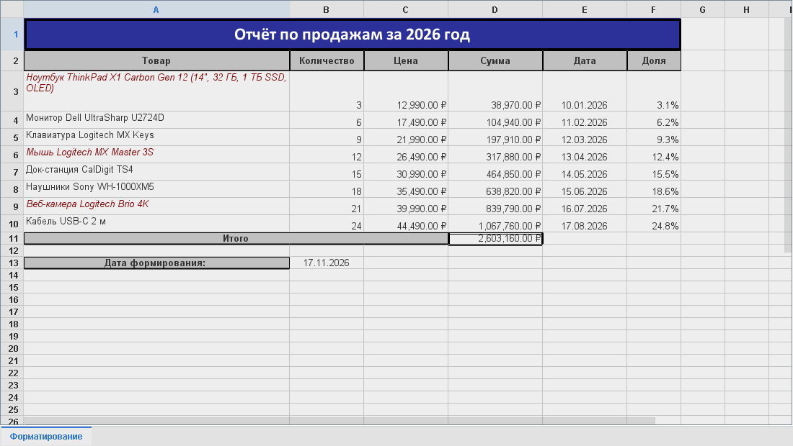
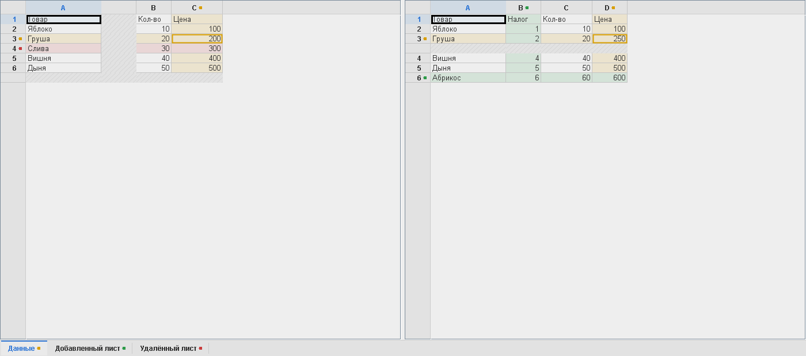

# XLS Viewer

**English** | [Русский](README.ru.md)

[](https://plugins.jetbrains.com/plugin/36262-xls-viewer)
[](LICENSE)

Plugin for IntelliJ IDEA **2026.2+ (build 262)** and **2026.3**: views legacy
Excel 97–2003 workbooks (`.xls`, BIFF8) and renders the formatting the way Excel
shows it, and compares two workbooks in a diff view (including from Git).

The plugin only reads files and never modifies them.





## Installation

**From the IDE:** **Settings → Plugins → Marketplace** → search for "XLS Viewer" →
Install → restart the IDE. Plugin page —
[plugins.jetbrains.com/plugin/36262-xls-viewer](https://plugins.jetbrains.com/plugin/36262-xls-viewer).

**Manually** (archive from [Releases](https://github.com/IljaGnezdilov/intellij-xls-viewer/releases)):

1. Download `xls-viewer-<version>.zip`.
2. **Settings → Plugins → ⚙ → Install Plugin from Disk…** → select the archive.
3. Restart the IDE.

The same archive works for both 2026.2 and 2026.3.

License — [MIT](LICENSE), third-party libraries — [THIRD-PARTY.md](THIRD-PARTY.md).

## Viewing (v1)

**Cells**
- font: name, size, bold, italic, underline, strikethrough, color;
- fill (solid; patterns are approximated with a solid color);
- borders: style and color for each of the four sides, including double borders;
- horizontal and vertical alignment, indent, text wrapping, shrink to fit,
  text rotation 0°/90°;
- number formats via `DataFormatter`: `General`, numbers, currency, percentages,
  fractions, scientific notation, dates and times, custom formats;
- formulas: the cached value is shown, the formula itself appears in the tooltip
  and in the status bar.

**Rows and columns**
- row heights and column widths, including the defaults;
- hidden rows and columns;
- merged cells (rendered across the whole area);
- freeze panes.

**Sheets**
- switch with the tabs at the bottom, the drop-down list in the toolbar, or
  `Ctrl+PgUp` / `Ctrl+PgDn`;
- hidden sheets are marked in the list;
- the selected sheet, cell and zoom level are remembered across IDE restarts.

**User interface**
- range selection with the mouse and with `Shift`+arrows;
- `Ctrl+C` copies the selection as TSV, which pastes into Excel/LibreOffice;
- zoom 50–300 %, grid toggle, "Excel colors" mode;
- the background of unfilled cells comes from the IDE theme; near-black text on
  a dark theme is automatically replaced with a contrasting color;
- status bar with the cell address, type and value;
- "Reload" and "Open in System" buttons;
- clear messages for password-protected files and for non-`.xls` files.

## Workbook diff (v2)

The plugin picks up a comparison of two `.xls` files automatically: "Show Diff"
in the Git log, "Compare with Local", Diff from Commit, and the regular two-file
comparison in the IDE.

- Two "before / after" panes with synchronized scrolling.
- Sheets are matched by name; the tabs at the bottom show the union of the
  sheets from both workbooks.
- Rows and columns are aligned, so an insertion does not shift the whole table:
  missing rows/columns are shown as a filler band with diagonal hatching.
- **Markers** — a round dot the height of a capital letter right after the label:
  - yellow — changed, green — added, red — deleted;
  - on sheet tabs, in row and column headers.
- **Outlines** — only on changed cells (yellow); added and deleted
  rows/columns are not outlined.
- Translucent band fills: yellow — changed row/column, green — added, red —
  deleted.
- **"Only changes"** — collapsed view: only changed rows and columns are shown
  (plus the first row/column as a header) with context 0–3 adjustable next to
  the checkbox. Added and deleted rows/columns are shown in full, tabs and the
  sheet list contain only sheets with changes, and skipped ranges are marked
  with a dashed line and `⋮` / `⋯` symbols. The mode is on by default
  (context 1), and the selected value is remembered.
- Zoom 50–300 % — applied to both panes at once.
- Clicking a row or column header puts the cursor at the first change in that
  row/column (for added/deleted ones — at the first marked cell).
- `▲` `▼` `◀` `▶` buttons and `Alt+↑` `Alt+↓` `Alt+←` `Alt+→` — jump to the
  previous/next changed row or column.
- `F7` / `Shift+F7` — jump to the next/previous change by rows.
- The status bar shows the cell value in both workbooks and the change counts.

Algorithm: columns are matched by the header row (the most populated row among
the first ten is used — this survives a merged title above the header), rows —
by patience diff over the contents of the shared columns; "holes" are matched
positionally, so an edit looks like a change rather than a delete + insert.

### Git LFS and "eternal loading"

If a `.xls` file is stored in Git LFS, IntelliJ fetches the revision contents
with `git cat-file --filters`. When the LFS object is not in the local cache,
that command goes to download it from the server, and **the diff tab hangs on
loading before the plugin even receives the contents** — the plugin cannot
influence this.

What the plugin does:

- recognizes the LFS pointer (`version https://git-lfs.github.com/spec/v1`) and
  instead of "the file is not a workbook" shows the OID, size and a
  "Copy command" button with `git lfs fetch origin` (and also reminds about
  `git lfs install` if the client is not installed); if the working copy is a
  real file, it offers an "Open working copy" button;
- if loading takes longer than 10 seconds, a hint about Git LFS appears under
  the "Comparing workbooks…" text;
- writes diagnostics to `idea.log`: side sizes, read/parse/diff times and the
  error — the `XLS diff content:` / `XLS diff ready:` lines show at which stage
  everything stopped.

The fix is to download the objects:

```bash
git lfs fetch origin
# or
git lfs pull
```

## Limitations

- only `.xls` (BIFF8); `.xlsx`/`.xlsm` — in future versions;
- read-only, no editing;
- not supported: charts, images, comments, conditional formatting, autofilter,
  row/column grouping, hyperlinks, formatting of individual characters inside a
  cell (rich text), password-protected workbooks;
- sheet tab color is not shown (Apache POI does not expose it for HSSF);
- the diff takes the used range of a sheet into account; "empty" trailing rows
  and columns do not participate in the diff.

## Build and installation

Requires IntelliJ IDEA **2026.2.4+ (build 262)** or **2026.3 (build 263)** and
JDK 25. The same artifact installs into both versions. The build uses the local
IDE installation, no distribution download is needed.

```bash
# builds against 2026.3 by default (path set in build.gradle.kts)
gradlew buildPlugin

# release build against the minimum supported version - 2026.2:
gradlew -PidePath="D:/Program Files/JetBrains/Toolbox2/IntelliJ IDEA" clean build buildPlugin
```

The default `idePath` value points to the author's local installation, so on
another machine it must be passed explicitly via
`-PidePath="<path to IntelliJ IDEA>"`.

Resulting archive: `build/distributions/xls-viewer-<version>.zip`.

Local installation without a dialog (the IDE must be closed):

```powershell
.\install-plugin.ps1                                    # 2026.3
.\install-plugin.ps1 -IdeConfigName IntelliJIdea2026.2  # 2026.2
```

After installation, `.xls` opens in the XLS Viewer editor, and a comparison of
two `.xls` files opens in the plugin's diff viewer.

## Development

```bash
# run the IDE sandbox with a demo file
gradlew runIde -Psample=build/samples/formatting.xls

# regenerate the demo workbooks (build/samples)
gradlew generateSamples

# parser, diff and offscreen rendering tests
gradlew test
```

The offscreen renderer puts PNGs into `build/reports/render/`:
`formatting.png`, `formatting-scrolled.png`, `large.png`, `diff.png`,
`diff-selection.png`, `diff-collapsed.png`, `diff-collapsed-gaps.png`,
`diff-150.png` — handy for checking the rendering without launching the IDE.

## Architecture

```
parse/   XlsParser        BIFF8 -> immutable model; the workbook is closed immediately
         StyleTableBuilder deduplication of XF/fonts, colors from the workbook palette
         CellTextFormatter DataFormatter + cached formula results
model/   XlsDocument, SheetModel, CellModel, CellStyleModel, CellRange,
         SheetDiffMarks (diff marks), SheetTab
ui/      GridGeometry     prefix sums of heights/widths, binary search for a cell
         XlsGridComponent owner-drawn virtualized grid (merge, freeze, borders,
                          diff tint and outlines, filler hatching)
         XlsHeaders       row/column headers, marker dots, corner
         XlsSheetTabs     sheet tabs with dots
         XlsTheme         colors matching the IDE theme, "Excel colors", diff colors
editor/  XlsFileEditorProvider / XlsFileEditor / XlsEditorPanel
diff/    XlsDiffTool / XlsDiffToolRegistrar   integration with the platform DiffTool API
         XlsDiffViewer / XlsDiffPanel       two panes, synchronized scrolling, tabs
         SheetDiffer                        sheet/row/column alignment, marks
         DiffSides                          synthetic SheetModels for the panes
         XlsDiffContents                    reading the diff sides and OLE2 validation
```

Why a custom grid instead of `JTable`: merged cells, freeze panes and exact
per-side borders cannot be expressed in `JTable` without workarounds. BIFF8 is
limited to 65536×256, so the geometry is stored in arrays and painting only
covers the visible area.

Diff integration: the plugin registers `com.intellij.diff.DiffTool`
programmatically (`XlsDiffToolRegistrar`) with `LoadingOrder.FIRST` — the
built-in binary viewer is registered by the platform before plugins and would
otherwise win the selection, and the `diff.DiffTool` extension has no `order`
attribute. Registering through the public extension API lets the plugin avoid
internal platform classes.

## Dependencies

- Apache POI 5.5.1 (`poi` plus transitive `commons-*`, `SparseBitSet`,
  `log4j-api`), pulled from Maven and packaged into the plugin's `lib/` during
  the build; licenses and copyright — in [THIRD-PARTY.md](THIRD-PARTY.md);
- IntelliJ Platform `com.intellij.modules.platform` — works in both Community
  and Ultimate.

On the first file parse, log4j-api may print a single
`Log4j API could not find a logging provider` line to the log — this is
harmless.
