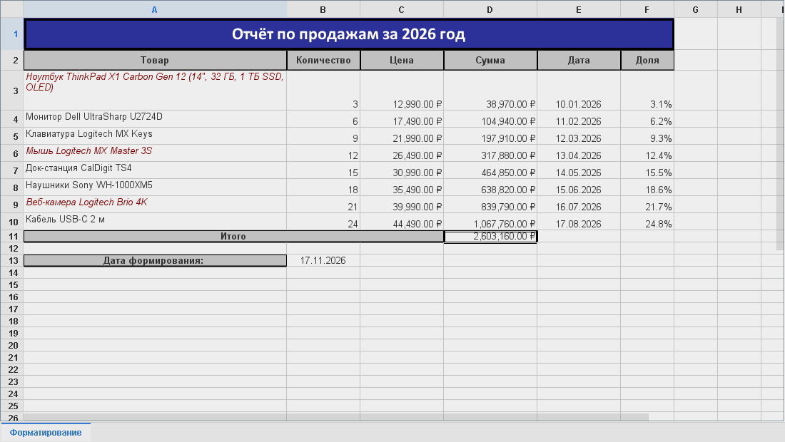
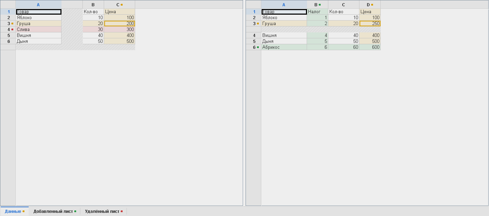

# XLS Viewer

[English](README.md) | **Русский**

[](https://plugins.jetbrains.com/plugin/36262-xls-viewer)
[](LICENSE)

Плагин для IntelliJ IDEA **2025.2+ (build 252)**: просмотр книг Excel — старых
`.xls` (BIFF8) и современных `.xlsx` — с отображением форматирования так, как его показывает
сам Excel, и сравнение двух книг в режиме диффа (в том числе из Git) в той же сетке,
с теми же маркерами и режимом «Только изменения».

Плагин только читает файлы и ничего не изменяет.

> Это перевод. Основная версия — [README.md](README.md); перевод может отставать от неё.





## Установка

**Из IDE:** **Settings → Plugins → Marketplace** → найти «XLS Viewer» → Install →
перезапустить IDE. Страница плагина — [plugins.jetbrains.com/plugin/36262-xls-viewer](https://plugins.jetbrains.com/plugin/36262-xls-viewer).

**Вручную** (архив из [Releases](https://github.com/IljaGnezdilov/intellij-xls-viewer/releases)):

1. Скачать `xls-viewer-<версия>.zip`.
2. **Settings → Plugins → ⚙ → Install Plugin from Disk…** → выбрать архив.
3. Перезапустить IDE.

Один и тот же архив подходит для IntelliJ IDEA 2025.2–2026.3 и новее.

Лицензия — [MIT](LICENSE), сторонние библиотеки — [THIRD-PARTY.md](THIRD-PARTY.md).

## Просмотр (v1)

**Ячейки**
- шрифт: имя, размер, полужирный, курсив, подчёркивание, зачёркивание, цвет;
- заливка (сплошная, паттерны аппроксимируются сплошной);
- границы: стиль и цвет для каждой из четырёх сторон, включая двойные;
- выравнивание по горизонтали и вертикали, отступ (indent), перенос текста,
  «уменьшить по размеру» (shrink to fit), поворот текста 0°/90°;
- числовые форматы через `DataFormatter`: `General`, числа, валюта, проценты,
  дроби, экспонента, даты и время, пользовательские форматы;
- формулы: показывается кэшированное значение, сама формула — в подсказке и в строке статуса.

**Строки и столбцы**
- высоты строк и ширины столбцов, включая значения по умолчанию;
- скрытые строки и столбцы;
- объединённые ячейки (отрисовка на всю область);
- закреплённые области (freeze panes).

**Листы**
- переключение вкладками внизу, выпадающим списком в панели и `Ctrl+PgUp` / `Ctrl+PgDn`;
- скрытые листы помечаются в списке;
- цвет вкладки листа из книг `.xlsx` показывается полоской под вкладкой;
- выбранный лист, ячейка и масштаб запоминаются между перезапусками IDE.

**Интерфейс**
- выделение диапазона мышью и `Shift`+стрелки;
- `Ctrl+C` — копирование выделения как TSV, вставляется в Excel/LibreOffice;
- масштаб 50–300 %, переключатель сетки, режим «Цвета Excel»;
- фон незалитых ячеек берётся из темы IDE, почти чёрный текст на тёмной теме
  автоматически заменяется контрастным;
- статусная строка с адресом, типом и значением ячейки;
- кнопки «Обновить» и «Открыть в системе»;
- аккуратные сообщения для файлов с паролем и для неподдерживаемых форматов.

В `.xlsx` дополнительно используются цвета и оттенки (tint) из темы книги,
общие и встроенные строки, а также система дат 1904.

## Сравнение книг (v2)

Плагин подхватывает сравнение двух `.xls`/`.xlsx` автоматически: «Show Diff» в логе Git,
«Compare with Local», Diff из Commit, а также обычное сравнение двух файлов в IDE.
Смешанное сравнение (ревизия `.xls` против `.xlsx`) тоже поддерживается.

- Две панели «было / стало» с синхронной прокруткой.
- Листы сопоставляются по имени; вкладки внизу — объединение листов обеих книг.
- Строки и столбцы выравниваются, поэтому вставка не «сдвигает» всю таблицу:
  отсутствующие строки/столбцы показываются полосой-заполнителем с диагональной штриховкой.
- **Маркеры** — круглая точка размером с высоту прописной буквы сразу после подписи:
  - жёлтая — изменено, зелёная — добавлено, красная — удалено;
  - на вкладках листов, в заголовках строк и столбцов.
- **Обводка** — только у изменённых ячеек (жёлтая); добавленные и удалённые
  строки/столбцы рамками не обводятся.
- Полупрозрачная заливка полос: жёлтая — изменённая строка/столбец, зелёная —
  добавленная, красная — удалённая.
- **«Только изменения»** — свёрнутый вид: видны только изменённые строки и
  столбцы (плюс первая строка/столбец как шапка) с контекстом 0–3, настраиваемым
  рядом с галочкой. Добавленные и удалённые строки/столбцы показываются целиком,
  вкладки и список листов содержат только листы с изменениями, а пропущенные
  диапазоны помечены пунктиром и символами `⋮` / `⋯`. Режим включён по умолчанию
  (контекст 1), выбранное значение запоминается.
- **«Показывать пустые изменения»** — по умолчанию выключено: различия, где обе
  ячейки пусты (ячейка только с оформлением против отсутствующей, пустой
  результат формулы, текст из пробелов), не помечаются, не считаются и не
  удерживают строки и столбцы в свёрнутом виде. Статусная строка показывает,
  сколько пустых различий скрыто. Добавленные и удалённые строки/столбцы
  показываются всегда, даже если в них нет значений. Включите галочку, чтобы
  увидеть пустые различия.
- Зум 50–300 % — применяется сразу к обеим панелям.
- Клик по заголовку строки или столбца ставит курсор в первое изменение этой
  строки/столбца (для добавленных/удалённых — в первую помеченную ячейку).
- Кнопки `▲` `▼` `◀` `▶` и `Alt+↑` `Alt+↓` `Alt+←` `Alt+→` — переход к
  предыдущей/следующей изменённой строке или столбцу.
- `F7` / `Shift+F7` — переход к следующему/предыдущему изменению по строкам.
- Строка статуса показывает значение ячейки в обеих книгах и счётчики изменений.

Алгоритм: колонки сопоставляются по строке заголовка (берётся самая заполненная
строка среди первых десяти — это переживает объединённый заголовок над шапкой),
строки — patience-diff по содержимому общих колонок; «дыры» сопоставляются
позиционно, поэтому правка выглядит как изменение, а не как удаление + вставка.

### Git LFS и «вечная загрузка»

Если `.xls`/`.xlsx` лежит в Git LFS, IntelliJ достаёт содержимое ревизии командой
`git cat-file --filters`. Когда объекта LFS нет в локальном кэше, эта команда
уходит качать его с сервера, и **вкладка диффа висит на загрузке ещё до того,
как плагин получает содержимое** — плагин на это повлиять не может.

Что делает плагин:

- распознаёт LFS-указатель (`version https://git-lfs.github.com/spec/v1`) и вместо
  «файл не является книгой» показывает OID, размер и кнопку «Скопировать команду»
  с `git lfs fetch origin` (а также напоминает про `git lfs install`, если клиент
  не установлен); если рабочая копия — настоящий файл, предлагает кнопку
  «Открыть рабочую копию»;
- если загрузка идёт дольше 10 секунд, под текстом «Сравнение книг…» появляется
  подсказка про Git LFS;
- пишет в `idea.log` диагностику: размеры сторон, время чтения/парсинга/диффа и
  ошибку — по строкам `XLS diff content:` / `XLS diff ready:` видно, на каком этапе
  всё остановилось.

Лечится это скачиванием объектов:

```bash
git lfs fetch origin
# или
git lfs pull
```

## Ограничения

- форматы: `.xls` (BIFF8) и `.xlsx`; `.xlsm`, `.xltx`, `.xlsb` и `.ods` не
  открываются редактором и диффом;
- только чтение, без редактирования;
- не поддерживаются: диаграммы, картинки, примечания, условное форматирование,
  автофильтр, группировка строк/столбцов, гиперссылки, форматирование отдельных
  символов внутри ячейки (rich text), книги с паролем;
- цвет вкладки листа доступен только для `.xlsx` (Apache POI не публикует его для HSSF);
- значения формул берутся из кэша книги; формулы не пересчитываются, поэтому файл,
  сохранённый без кэшированных результатов, покажет пустые ячейки формул;
- при сравнении учитывается используемый диапазон листа; «пустые» хвосты строк и
  столбцов не участвуют в диффе;
- книга с более чем пятью миллионами материализованных ячеек обрезается
  (в разобранный документ добавляется предупреждение), чтобы искусственно
  оформленный `.xlsx` не исчерпал память IDE.

## Сборка и установка

Требуется IntelliJ IDEA **2025.2+ (build 252)**. Артефакт собирается против 2025.2, поэтому
один архив работает на 2025.2–2026.3 и новее. Для компиляции нужен JDK 25, но байткод
намеренно **Java 21**: 2025.2–2026.1 работают на JBR 21 и не смогут загрузить классы Java 25.

Дистрибутив 2025.2 (около 1.3 ГБ) скачивает IntelliJ Platform Gradle Plugin при первой сборке,
ставить IDE вручную не нужно.

```bash
# релизная сборка: компиляция против 2025.2, минимальной поддерживаемой версии
gradlew clean build buildPlugin

# повседневная разработка против локально установленной IDE
gradlew -PtargetIde=local "-PidePath=<путь к IntelliJ IDEA>" runIde
```

Значение `idePath` по умолчанию указывает на локальную установку автора, поэтому на другой
машине при `-PtargetIde=local` его нужно передать явно.

Готовый архив: `build/distributions/xls-viewer-<версия>.zip`.

Локальная установка без диалога (IDE должна быть закрыта):

```powershell
.\install-plugin.ps1                                    # новая локальная IDE (2026.3)
.\install-plugin.ps1 -IdeConfigName IntelliJIdea2025.2  # 2025.2
.\install-plugin.ps1 -IdeConfigName IntelliJIdea2026.2  # 2026.2
```

После установки `.xls` и `.xlsx` открываются в редакторе XLS Viewer, а сравнение
двух книг (или `.xls` с `.xlsx`) открывается в дифф-просмотрщике плагина.

## Разработка

```bash
# запустить песочницу IDE с демонстрационным файлом
gradlew runIde -Psample=build/samples/formatting.xls
gradlew runIde -Psample=build/samples/formatting.xlsx

# пересоздать демонстрационные книги (build/samples)
gradlew generateSamples

# тесты парсера, диффа и офскрин-рендеринг
gradlew test
```

Офскрин-рендер складывает PNG в `build/reports/render/`:
`formatting.png`, `formatting-xlsx.png`, `formatting-scrolled.png`, `large.png`,
`diff.png`, `diff-xlsx.png`, `diff-selection.png`, `diff-collapsed.png`,
`diff-collapsed-gaps.png`, `diff-150.png` — удобно проверять отрисовку без запуска IDE.

## Архитектура

```
parse/   WorkbookParser     BIFF8 (HSSF) и OOXML (XSSF) -> неизменяемая модель;
                            workbook закрывается сразу
         StyleTableBuilder  дедупликация XF/шрифтов, выравнивание, границы
         StyleColors        индексная палитра BIFF против RGB/темы/tint в OOXML
         CellTextFormatter  DataFormatter + кэшированные результаты формул, даты 1900/1904
         WorkbookFormats    расширения, которые открывают редактор и дифф
model/   XlsDocument, SheetModel, CellModel, CellStyleModel, CellRange,
         SheetDiffMarks (метки диффа), SheetTab
ui/      GridGeometry     префиксные суммы высот/ширин, бинарный поиск ячейки
         XlsGridComponent owner-drawn виртуализированный грид (merge, freeze, границы,
                          тонировка и обводки диффа, штриховка заполнителей)
         XlsHeaders       заголовки строк/столбцов, точки-маркеры, угол
         XlsSheetTabs     вкладки листов с точками и цветом вкладки
         XlsTheme         цвета под тему IDE, «Цвета Excel», цвета диффа
editor/  XlsFileEditorProvider / XlsFileEditor / XlsEditorPanel
diff/    XlsDiffTool / XlsDiffToolRegistrar   интеграция с DiffTool API платформы
         XlsDiffViewer / XlsDiffPanel       две панели, синхронный скролл, вкладки
         SheetDiffer                        выравнивание листов/строк/столбцов, метки
         DiffSides                          синтетические SheetModel для панелей
         XlsDiffContents                    чтение сторон диффа и проверка содержимого
```

Почему свой грид, а не `JTable`: объединённые ячейки, закреплённые области и
точные границы по сторонам в `JTable` не выражаются без костылей. `.xls` ограничен
65536×256, `.xlsx` — 1048576×16384, поэтому геометрия хранится массивами, строка
держит только свои столбцы, а рисование идёт только по видимой области.

Интеграция с диффом: плагин регистрирует `com.intellij.diff.DiffTool` программно
(`XlsDiffToolRegistrar`) с `LoadingOrder.FIRST` — встроенный бинарный просмотрщик
регистрируется платформой раньше плагинов и иначе выигрывает выбор, а у расширения
`diff.DiffTool` нет атрибута `order`. Регистрация через публичный API расширений
позволяет обойтись без внутренних классов платформы.

## Зависимости

- Apache POI 5.5.1 (`poi` и `poi-ooxml` + транзитивные `xmlbeans`,
  `poi-ooxml-lite`, `commons-compress`, `commons-*`, `SparseBitSet`, `log4j-api`),
  подключается из Maven и упаковывается в `lib/` плагина при сборке; лицензии и
  copyright — в [THIRD-PARTY.md](THIRD-PARTY.md);
- IntelliJ Platform `com.intellij.modules.platform` — работает и в Community, и в Ultimate.

При первом разборе файла log4j-api может напечатать в лог одну строку
`Log4j API could not find a logging provider` — это безвредно.
